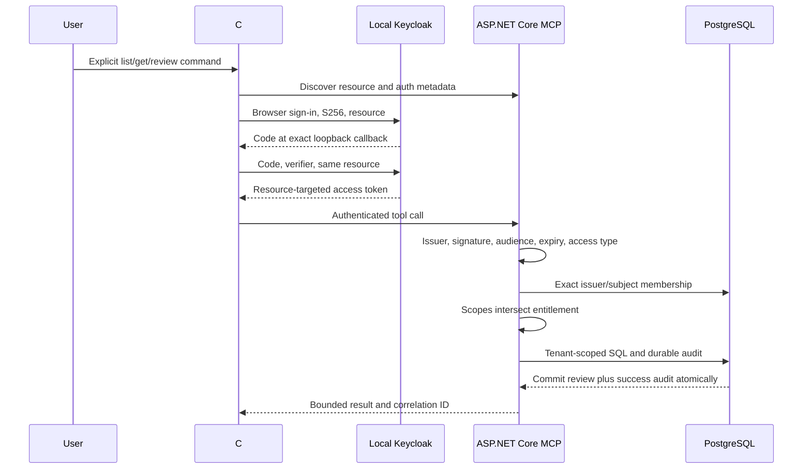

# Architecture

This local demo has three tools and six fictional deliveries. The SDK CLI discovers
the protected-resource metadata, opens the system browser for authorization code with
PKCE, and sends its in-memory access token to ASP.NET Core. A single Keycloak realm
provides synthetic identity; two business tenants live in PostgreSQL.

Reads and denied calls require durable audit before success/data returns. A review
locks only the authorized tenant row, checks status/version, increments once, and
writes the success audit in the same transaction. Conflict/not-found audit uses a
separate transaction after rollback. Audit outage returns unavailable without data
or mutation. An unavailable database cannot also record its own outage there.

Carrier notes are labelled untrusted fields. Deliberate forbidden calls after reading
the malicious note prove the deterministic service boundary. No language model is
part of the experiment. There is no claim about model obedience or robustness.

The fixed public native client and short-expiry test client are pre-registered.
Keycloak resource-indicators is experimental in the pinned image. Local development
HTTP, one application/database and a fixed membership set bound this demonstration.
There is no cloud deployment, remote HTTPS acceptance, production identity lifecycle,
availability/failover design, or tenant administration surface.
